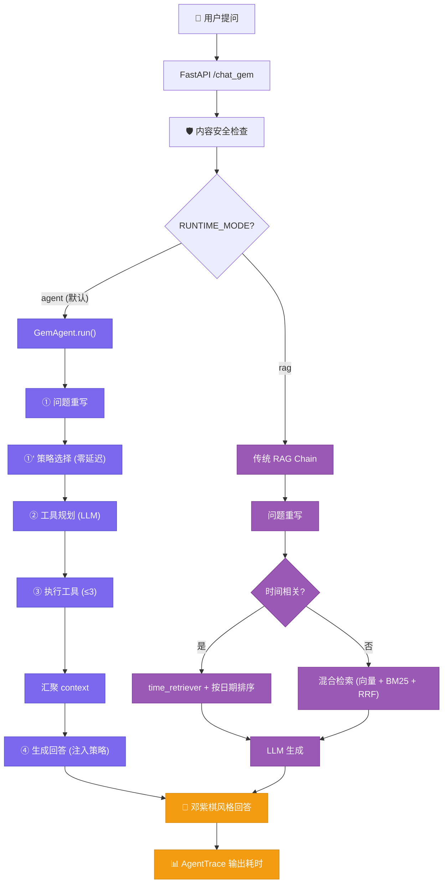

<div align="center">

# 🤖 GEM Fan Club · RAG Agent

**邓紫棋粉丝俱乐部 — AI 聊天 / RAG / Agent 服务**

[](https://www.python.org/)
[](https://fastapi.tiangolo.com/)
[](https://www.trychroma.com/)
[](https://www.zhipuai.cn/)
[](https://www.langchain.com/)
[](#-许可证)

基于 **RAG + Strategy-Enhanced Agent** 的邓紫棋人设智能问答系统，能够以邓紫棋的语气与粉丝自然对话。

</div>

---

## 🧭 项目矩阵

`GEM Fan Club` 由四个独立仓库构成，本仓库为**AI 智能层**，由后端通过 SSE 反向代理对外服务：

```
┌─────────────────────────┐  HTTP/SSE  ┌─────────────────────────┐
│  GEM-FAN-CLUB-VUE  🎨   │ ─────────► │  GEM-FAN-CLUB-WEB  ⚙️   │
│  Vue 3 · Vite · Pinia   │            │  Spring Boot · MySQL    │
└─────────────────────────┘            │  Redis · WebFlux        │
                                       └────────┬────────────────┘
                                                │ /chat_gem(/stream)
                                                ▼
┌─────────────────────────┐    sync    ┌─────────────────────────┐
│  GEM_FAN_CLUB_DATA_PY 📷│ ─────────► │  GEM_FAN_CLUB_RAG  🤖   │
│  Weibo + VLM 图片流水线 │            │  RAG · Agent · GLM-4.7  │
└─────────────────────────┘            │  （本仓库）              │
                                       └─────────────────────────┘
```

---

## ✨ 核心特性

### 🎭 智能角色扮演
- **100% 邓紫棋人设** — 完全模拟说话风格和语气
- **多轮对话** — 上下文感知，对话历史自动截断（可配置轮数）
- **时间感知** — LLM 自主调用时间工具，准确判断事件时间线
- **情感表达** — 根据话题调整回答的情感色彩

### 🧠 v2.5 Strategy-Enhanced Agent

LLM **自主决策**调用工具，并通过**动态策略增强**提升回答质量：

| 工具                           | 功能                                   | Skill          |
| ------------------------------ | -------------------------------------- | -------------- |
| `search_knowledge_base`        | 通用知识库检索（生涯 / 个人 / 奖项）   | KnowledgeSkill |
| `search_concert_schedule`      | 演唱会日程检索（按时间排序）           | KnowledgeSkill |
| `search_song_info`             | 歌曲信息检索（歌词 / 创作背景）        | KnowledgeSkill |
| `get_current_datetime`         | 获取当前时间（含星期几）               | UtilitySkill   |
| `get_hot_songs_recommendation` | 热门歌曲推荐（支持偏好筛选）           | RecommendSkill |
| `lookup_artist_profile`        | 结构化档案查询（零幻觉事实数据）       | ProfileSkill   |
| `lookup_milestones`            | 里程碑事件查询（按年 / 类别筛选）      | ProfileSkill   |

### 🎯 Prompt 策略池（零延迟 SkillsBank）

借鉴 S-Model / Selection Model 架构，**关键词 + 正则规则引擎**自动选择策略并注入 system prompt：

| 策略           | 触发场景                | 注入效果                    |
| -------------- | ----------------------- | --------------------------- |
| 🎵 歌词深度解读 | "歌词含义" / "创作背景" | 引用歌词原文，分析情感表达  |
| 🎤 演唱会热情   | "演唱会" / "巡演"       | 兴奋语气，分享幕后趣事      |
| 💝 温暖共情     | "难过" / "加油"         | 先共情再鼓励，推荐安慰歌曲  |
| 😄 轻松幽默     | "哈哈" / "好玩"         | 开玩笑，展现活泼可爱一面    |
| 📊 精确事实     | "什么时候" / "几岁"     | 基于数据精确回答，不编造    |
| 🎶 歌曲推荐     | "推荐" / "好听的歌"     | 带感情描述，个人视角分享    |
| 💕 粉丝互动     | "喜欢你" / "棋士"       | 热情回应，表达对粉丝的爱    |
| 📖 成长故事     | "出道" / "经历"         | 按时间线娓娓道来，分享心路  |

### 🛡️ LLM 输出守护（Output Guard）

针对模型输出不规范导致的链路故障，建立**全链路防护体系**：

| 环节       | 守护策略                                           | 降级方案                       |
| ---------- | -------------------------------------------------- | ------------------------------ |
| 🔄 问题重写 | 重试 + 输出清洗（去前缀 / 去引号 / 长度校验）      | 回退到原始问题                 |
| 🎯 工具规划 | 重试 + JSON 多策略解析 + **工具名幻觉过滤** + 模糊匹配 | 回退到 `search_knowledge_base` |
| 💬 回答生成 | 重试 + 空内容检测 + AI 身份泄露过滤                | GEM 人设兜底回复               |
| 🌊 流式回答 | 重试 + 流式 buffer 监控 + 空流检测                 | GEM 人设兜底回复               |

> 核心设计：指数退避重试 · 工具名幻觉过滤（大小写 / 下划线 / CamelCase 模糊匹配）· 提示词格式约束（合法 / 非法示例）· 人设一致性兜底。

### 📊 链路追踪（AgentTrace）

每次请求自动记录各阶段耗时：

```
┌─ AgentTrace ─────────────────────────────────
│ Question : 邓紫棋什么时候生日
│ Total    : 3,241.0 ms
├─ rewrite    :   812.3 ms ✓
├─ strategy   :     0.2 ms ✓  精确事实
├─ planning   :   923.1 ms ✓
├─ execute    :   456.7 ms ✓  lookup_artist_profile
├─ generate   : 1,034.2 ms ✓
│ tools_called: ['lookup_artist_profile']
│ strategies : ['精确事实']
└──────────────────────────────────────────────
```

### 🔍 检索技术

- **自适应分块** — 生涯按时间线，演唱会保持表格结构，歌词整首为一块
- **混合检索** — ChromaDB 向量检索 + jieba BM25 关键词检索
- **RRF 重排序** — Reciprocal Rank Fusion 科学融合
- **问题重写** — LLM 智能改写，提高检索准确性

### 📚 知识库

- **生涯数据** — 成长历程、重要成就（按时期分文件）
- **演唱会** — 巡演记录、I AM Gloria 等场次详情
- **歌词库** — 完整歌词 + 创作背景
- **结构化档案** — `artist_profile.json` / `milestones.json`（零幻觉查询源）
- **热门歌曲** — `hot_song.json` 推荐数据

---

## 🛠️ 技术栈

| 技术          | 版本    | 用途                           |
| ------------- | ------- | ------------------------------ |
| Python        | 3.8+    | 主语言                         |
| FastAPI       | 0.116.1 | 异步 Web 框架                  |
| ChromaDB      | 1.0.20  | 向量数据库                     |
| ZhipuAI       | GLM-4.7 | 大语言模型（对话 + Embedding） |
| LangChain     | 0.3.27  | RAG 编排框架                   |
| jieba         | Latest  | 中文分词（BM25）               |
| uvicorn       | 0.35.0  | ASGI 服务器                    |
| Pydantic      | 2.10.4  | 数据验证                       |
| python-dotenv | 1.0.1   | 环境变量管理                   |
| python-docx   | 1.2.0   | Word 文档解析                  |

---

## 🚀 快速开始

```bash
# 1. 克隆 & 创建虚拟环境
git clone https://github.com/Reyotsed/GEM_FAN_CLUB_RAG.git
cd GEM_FAN_CLUB_RAG
python -m venv venv && source venv/bin/activate     # Linux/Mac
# venv\Scripts\activate                              # Windows

# 2. 安装依赖
pip install -r requirements.txt

# 3. 配置 API Key（任选一种）
export ZHIPUAI_API_KEY="your_api_key"
# 或写入 .env：ZHIPUAI_API_KEY=your_api_key

# 4. 数据准备（首次：构建向量库）
python load_data.py

# 5. 启动服务
python rag_server.py                  # 默认 Agent 模式
python rag_server.py --mode rag       # 传统 RAG 模式
```

> **环境要求**：Python 3.8+ · 智谱 AI API Key · 内存 ≥ 8GB

### 运行模式

| 模式              | 启动方式                                 | 说明                 |
| ----------------- | ---------------------------------------- | -------------------- |
| **Agent**（默认） | `python rag_server.py` 或 `--mode agent` | LLM 自主决策调用工具 |
| **RAG**           | `--mode rag` 或 `RUNTIME_MODE=rag`       | 传统检索增强生成     |

### 访问地址

- API 服务: `http://localhost:8000`
- Swagger 文档: `http://localhost:8000/docs`
- 健康检查: `http://localhost:8000/`

---

## 📡 API 文档

### `POST /chat_gem` — 同步聊天

```json
// Request
{
  "question": "你最近在忙什么？",
  "history": [
    { "role": "user",      "content": "你好" },
    { "role": "assistant", "content": "你好！很高兴见到你！" }
  ]
}

// Response
{
  "answer": "我最近在准备新专辑呢！虽然很忙，但看到你们支持我就充满动力！"
}
```

### `POST /chat_gem/stream` — 流式聊天（SSE）

请求体同上，响应为 `text/event-stream`：

| event    | data                                 | 说明              |
| -------- | ------------------------------------ | ----------------- |
| `status` | `{"stage": "...", "message": "..."}` | 阶段状态通知      |
| `token`  | `{"content": "..."}`                 | 逐 token 流式输出 |
| `done`   | `{}`                                 | 生成完毕          |
| `error`  | `{"message": "..."}`                 | 错误（极少触发）  |

### `GET /` — 健康检查

```json
{ "message": "欢迎使用 G.E.M. AI Chat API，服务运行正常！" }
```

---

## 📁 项目结构

```text
GEM_FAN_CLUB_RAG/
├── rag_server.py                   # FastAPI 主程序（双模式运行）
├── config.py                       # 全局配置（环境变量驱动）
├── load_data.py                    # 数据加载 & 向量化入口
├── requirements.txt
├── hot_song.json                   # 热门歌曲推荐数据
│
├── agent/                          # v2.5 Agent 模块
│   ├── gem_agent.py                # 编排核心（重写 → 策略 → 规划 → 执行 → 生成）
│   ├── prompt_strategy.py          # Prompt 策略池（零延迟规则引擎）
│   ├── trace.py                    # 链路追踪 AgentTrace
│   ├── llm_guard.py                # LLM 输出守护（重试 / 校验 / 降级）
│   └── skills/                     # Skill 集合
│       ├── base_skill.py           # 抽象基类 + FunctionResult
│       ├── skill_registry.py       # Skill 注册中心
│       ├── knowledge_skill.py      # 知识检索（3 个工具）
│       ├── profile_skill.py        # 结构化档案（零幻觉）
│       ├── recommend_skill.py      # 推荐
│       └── utility_skill.py        # 通用工具（时间等）
│
├── rag_modules/                    # RAG 核心
│   ├── data_preparation.py         # 数据清洗、元数据增强
│   ├── adaptive_splitter.py        # 自适应分块器
│   ├── hybrid_retriever.py         # 混合检索 + RRF 重排序
│   ├── prompts.py                  # Prompt 模板
│   └── content_safety.py           # 内容安全检查
│
├── gem_data/                       # 知识库数据
│   ├── career/                     # 生涯（00_overview ~ 12_awards_misc）
│   ├── concert/I AM Gloria.json    # 演唱会
│   ├── lyrics/*.txt                # 歌词
│   └── structured/
│       ├── artist_profile.json     # 艺人档案
│       └── milestones.json         # 里程碑事件
│
└── scripts/
    └── get_lyrics.py               # 歌词抓取脚本
```

---

## 🔁 核心流程



> 完整版流程图（含 7 个工具的检索链路）见 [`gem_rag_flowchart.md`](./gem_rag_flowchart.md)。

---

## ⚙️ 配置项

所有配置通过环境变量或 `.env` 管理：

| 配置项                         | 默认值             | 说明                                       |
| ------------------------------ | ------------------ | ------------------------------------------ |
| `ZHIPUAI_API_KEY`              | （必填）           | 智谱 AI 密钥                               |
| `ZHIPUAI_MODEL`                | `glm-4.7`          | 对话模型                                   |
| `ZHIPUAI_EMBEDDING_MODEL`      | `embedding-3`      | 向量化模型                                 |
| `ZHIPUAI_TEMPERATURE`          | `0.8`              | 生成温度                                   |
| `ZHIPUAI_TIMEOUT`              | `120`              | API 超时（秒）                             |
| `VECTOR_RETRIEVER_K`           | `10`               | 向量检索 Top-K                             |
| `BM25_RETRIEVER_K`             | `10`               | BM25 检索 Top-K                            |
| `HYBRID_RETRIEVER_NUM_RESULTS` | `5`                | 混合检索最终结果数                         |
| `HISTORY_MAX_TURNS`            | `5`                | 对话历史最大轮数                           |
| `AGENT_PLANNING_TEMPERATURE`   | `0.1`              | Agent 工具规划温度（低温更确定）           |
| `AGENT_MAX_TOOL_CALLS`         | `3`                | 单轮最大工具调用数                         |
| `AGENT_LLM_MAX_RETRIES`        | `2`                | LLM 调用最大重试次数（重写 / 生成）        |
| `AGENT_PLANNING_MAX_RETRIES`   | `2`                | 工具规划步骤最大重试次数                   |
| `RRF_K`                        | `60`               | RRF 重排序常数                             |
| `HOST` / `PORT`                | `0.0.0.0` / `8000` | 服务地址                                   |

---

## 📋 版本历史

| 版本       | 日期       | 核心变更                                               |
| ---------- | ---------- | ------------------------------------------------------ |
| **v2.5.1** | 2026-03-19 | LLM 输出守护：全链路重试 + 格式校验 + 降级兜底         |
| **v2.5.0** | 2026-03-19 | 策略增强 Agent：Prompt 策略池 + 链路追踪 + 动态 Prompt |
| **v2.1.0** | 2026-03-05 | Skill 架构重构 + 结构化档案查询 + 内容安全检查         |
| **v2.0.0** | 2026-03-03 | Tool-Augmented Agent，LLM 自主决策工具调用             |
| **v1.1.0** | —          | 质量改进：限流、去重、K 值调优、日志优化               |
| **v1.0.0** | —          | 初始版本：混合检索 + RRF + 角色扮演                    |

> 详细变更日志见 [CHANGELOG.md](CHANGELOG.md)。

### 未来规划

- **v2.6** — `asyncio.gather` 并行化（问题重写 ∥ BM25 预检索）、ProbeSkill 追问检测
- **v3.0** — ReAct 多步推理 + 自进化闭环（对话日志 + 离线分析）
- **v4.0** — Multi-Agent + 微博爬虫 + 多媒体

---

## 🔗 关联仓库

| 仓库                     | 角色                       | 链接                                                       |
| ------------------------ | -------------------------- | ---------------------------------------------------------- |
| **GEM-FAN-CLUB-VUE**     | Vue 3 前端                 | [GitHub](https://github.com/Reyotsed/GEM-FAN-CLUB-VUE)     |
| **GEM-FAN-CLUB-WEB**     | Spring Boot 后端 API       | [GitHub](https://github.com/Reyotsed/GEM-FAN-CLUB-WEB)     |
| **GEM_FAN_CLUB_DATA_PY** | 微博图片 + VLM 打分流水线  | 同 monorepo 下 `GEM_FAN_CLUB_DATA_PY/`                     |

---

## 🙏 致谢

- [智谱 AI](https://www.zhipuai.cn/) — 中文大语言模型
- [LangChain](https://langchain.com/) — RAG 框架
- [ChromaDB](https://www.trychroma.com/) — 向量数据库
- [FastAPI](https://fastapi.tiangolo.com/) — Web 框架

---

## 📄 许可证

[MIT License](LICENSE)

---

<div align="center">

⭐ 如果这个项目对你有帮助，欢迎 Star ｜ Made with ❤️ for **G.E.M.** fans

</div>
